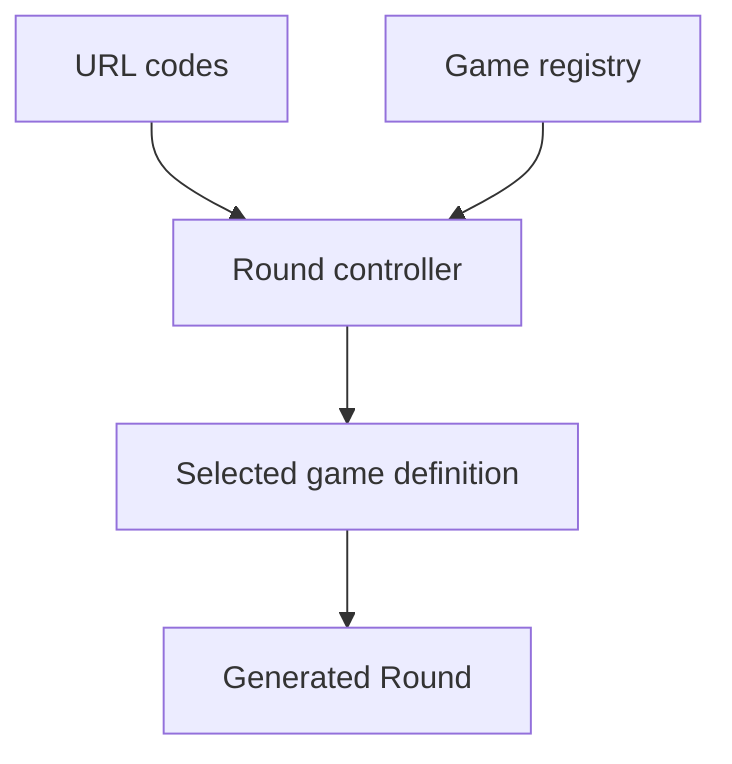
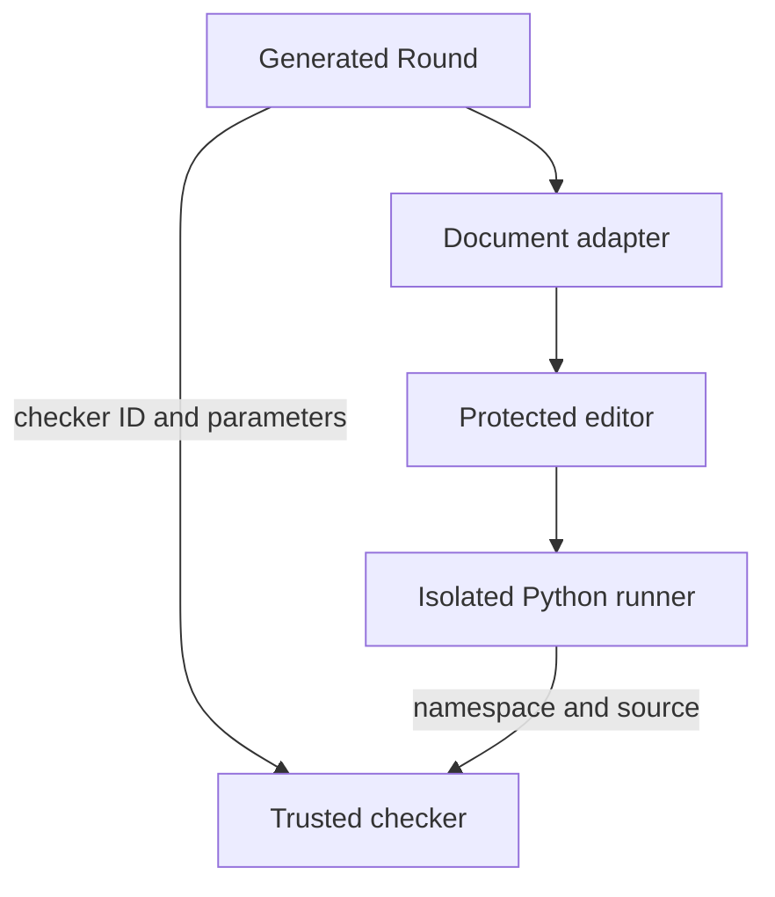

# Python microgames: one round contract, many small skills

This is a design proposal, not implemented scaffolding. Today, two generators live in `web/src/lib/microgames.ts`; the editor/controller is in `Microgames.astro`, URL validation is in `microgame-config.ts`, and execution/checking use `microgame-runner.ts` and `public/microgame-checker.py`.

The organizing idea: **a game definition generates a round; a round describes a document with fixed and editable segments; the editor renders that document; the runner executes its complete text and checks the outcome.** A fill-in-the-blank and a blank-page exercise use the same document contract.

```portable-model
version: 1
recipe: architecture
vocabulary:
  definition:
    label: Trusted game definition
  module:
    label: Executing module
  data:
    label: Data contract
presentation:
  definition: definition
  module: module
  data: data
```

## From URL to a generated round

A category is for organizing the catalog, not a separate engine. Each registered game owns its allowed settings, deterministic generation, and checker identity. Config remains JSON selecting registered games and settings; it contains no functions or Python templates. Only trusted application code generates executable scaffolding.


```portable-canvas
title: Select and generate
kinds:
  codes: data
  controller: module
  registry: module
  game: definition
  round: data
legend:
  entries:
    - kind: data
    - kind: module
    - kind: definition
```
```portable-nodes
codes:
  component: card
  title: Config Code + Round Code
  body: Config selects game entries and settings. Round selects an entry and seed. Multiple entries may select the same game.
  footer:
    text: Existing microgame-config.ts; extend validation
controller:
  component: card
  title: Round controller
  body: Decode and validate codes. Resolve the selected registered game. Supply settings and seeded randomness. New round preserves the selected entry.
  footer:
    text: Proposed microgames/controller.ts; extracted from Microgames.astro
registry:
  component: card
  title: Game registry
  body: Explicit allowlist of game IDs and their definitions. Shared lookup for generation and settings validation. No dynamic loading from a URL.
  footer:
    text: Proposed microgames/registry.ts
game:
  component: card
  title: Game definition
  body: Category, allowed settings, generator, checker ID. One module per coherent skill family; variants share a definition when their generation and checks overlap.
  footer:
    text: Proposed microgames/games/dictionary.ts, classes.ts, datetime.ts, etc.
round:
  component: card
  title: Generated Round
  body: Prompt + fixed/input document segments + checker ID and JSON parameters. Each input has a stable ID, initial text and optional hint solution.
  footer:
    text: Proposed microgames/contracts.ts
```

## From a round to a working program

The adapter knows CodeMirror; game definitions do not. The protected-region extension knows document boundaries, not Python or game rules. The runner knows isolation and execution, not editor widgets.


```portable-canvas
title: Edit, execute and check
kinds:
  round: data
  adapter: module
  editor: module
  runner: module
  checker: definition
legend:
  entries:
    - kind: data
    - kind: module
    - kind: definition
```
```portable-nodes
round:
  component: card
  title: Generated Round
  body: A portable description of what to show, where typing is allowed and which outcome to check.
  footer:
    text: Proposed microgames/contracts.ts
adapter:
  component: card
  title: Document adapter
  body: Concatenate segments; record input boundaries; place the cursor; bind per-input ghost hints; create fixed-line and inline decorations.
  footer:
    text: Proposed editor/round-document.ts
editor:
  component: card
  title: Protected-region extension
  body: Track editable ranges as text changes. Reject edits crossing fixed content. Keep empty inputs usable. Style fixed content with theme tokens. Preserve selection and copying.
  footer:
    text: Proposed editor/protected-regions.ts
runner:
  component: card
  title: Isolated Python runner
  body: Execute the entire visible document. Keep network blocking, fresh runs, Stop and time/output limits. Remove hidden numbers injection.
  footer:
    text: Existing microgame-runner.ts; modify source handling
checker:
  component: card
  title: Checker dispatch
  body: Resolve an allowlisted checker ID. Check resulting values, mutations or behavior; inspect syntax only when the task requires a particular construct. Hints are examples, not equality targets.
  footer:
    text: Existing public/microgame-checker.py; split trusted functions as it grows
```

## A concrete round

```ts
{
  prompt: 'Assign age from profile, using 0 when the key is missing.',
  document: [
    { kind: 'fixed', text: 'profile = {"name": "Maya"}\n\nage = ' },
    { kind: 'input', id: 'lookup', initial: '', solution: 'profile.get("age", 0)' },
    { kind: 'fixed', text: '\n' }
  ],
  check: { id: 'dict.lookup', params: { variable: 'age', expected: 0 } }
}
```

A whole-program round instead declares one empty input segment. An intermediate round supplies imports and a function signature, then leaves its body editable. These are document shapes, not three parallel engine systems. Progressively removing scaffolding prepares the user for a blank editor. This progression is a proposed way to compose rounds, not a new product mode or persistence feature.

For this lookup task, check the requested result and, if the task explicitly requires `.get`, the relevant syntax. A correct value alone cannot demonstrate general lookup behavior: stronger function-oriented rounds can call the user's function with both present and missing keys. Start with the appropriate check for each task rather than a universal template/equality checker.

## Candidate game catalog

All are proposals. Categories organize browsing and files; individual operations are variants when they share a generator and checker.

| Category | Small tasks / blanks | Later blank-editor task |
|---|---|---|
| Dictionaries | Lookup/default; assign/remove; iterate items; increment a count | Write a word-count function |
| Lists and stacks | Index/slice; append/extend; pop; push/pop; replace an item | Write a function that maintains a small stack |
| Sorting | Sort a copy/in place; reverse; key function; sort records by a field | Define a function sorting records by two fields |
| Sets | Membership; add/discard; intersection/difference; deduplicate | Find shared IDs across two inputs |
| Functions and calls | Define/return; positional/keyword arguments; default arguments; unpack arguments | Define and call a function with a default parameter |
| Classes | Construct an instance; call a method; mutate an attribute; implement a method using self; dataclass defaults | Define a class and use two instances |
| Strings | Split/join; strip; replace; f-string; case normalization | Parse a short delimited record |
| Iteration | enumerate; zip; unpack pairs; accumulate; early return | Implement a short loop-based transformation |
| Datetime | Construct a date; parse/format; add timedelta; subtract dates; compare dates; aware UTC datetime | Define a function calculating a due date |
| Argparse | Add a positional/optional argument; type=int; store_true; read parsed attributes | Define a parser and parse supplied arguments |
| JSON | loads/dumps; access nested data; transform decoded records | Decode input, transform it and encode output |
| Exceptions | Raise ValueError; catch an expected exception; return a fallback | Validate input with a clear failure path |
| Standard containers | Counter; defaultdict; deque append/popleft | Group records or consume a small queue |

For datetime, use explicit input dates and timezone-aware values where appropriate; avoid a moving 'today' in graded expectations. For argparse, call `parse_args(["--count", "3"])` rather than depending on browser process arguments. File-I/O exercises can come later using per-run virtual files; they are not needed to establish this foundation.

These are interview preparation candidates, not a claim about question frequency. Prioritize data structures, functions, object use and basic iteration; datetime and argparse expand practical Python fluency.

## Proposed source layout

```text
web/src/lib/
  microgame-config.ts             # URL codec + top-level config validation (existing)
  microgame-runner.ts             # isolated execution (existing)
  microgames/
    contracts.ts                 # GameDefinition, Round, Segment, CheckSpec
    registry.ts                  # explicit game allowlist
    controller.ts                # validated selection + deterministic generation
    games/
      classes.ts                 # existing class generator moves here
      comprehensions.ts          # existing comprehension generator moves here
      dictionary.ts              # lookup/update/count variants
      lists.ts                   # indexing, mutation, stack variants
      sorting.ts
      functions.ts
      datetime.ts
      argparse.ts
  editor/
    protected-regions.ts          # generic CodeMirror boundary enforcement
    round-document.ts            # round segments -> text/ranges/hints/decorations
web/public/
  microgame-checker.py            # trusted checker dispatch + functions (existing)
web/src/components/
  Microgames.astro                # page composition; existing controller logic extracted
  MicrogameEngineConfig.astro     # existing configuration controls
  MicrogameRound.astro            # existing round controls and prompt
```

Only create game files as their games are implemented. Keep Python checkers together initially; split into self-hosted trusted assets only when needed, updating the runner asset allowlist at that time. Topic metadata does not need another runtime subsystem.

## Smallest implementation sequence

1. Add the segment contract, adapter and protected-region extension. Convert existing comprehensions to a fixed numbers definition plus an input; preserve class rounds as one whole-document input. Check boundary typing, paste/cut, empty inputs, multiline inputs, undo/redo and hints.
2. Extract the existing generators into game modules and use one explicit registry for settings validation and generation. Introduce explicit checker dispatch: unknown IDs must fail rather than fall through to another checker.
3. Add dictionary lookup and instance/method-call rounds to exercise inline blanks and multiple segments. Verify alternative valid answers and incorrect outcomes.
4. Add sorting, datetime and argparse through the same contract. Add a second game-specific abstraction only when repeated implementations justify it.

URL configs remain data selecting trusted capabilities. No local storage or user-supplied executable functions are needed for this scaffolding. Changing generated content later may require a URL/generator version policy to keep old Round Codes replayable; the current version/seed scheme does not freeze generator implementations.
